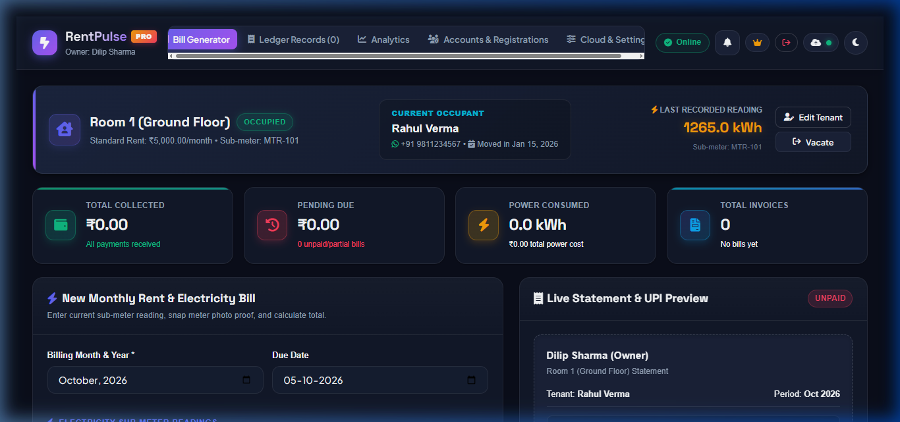
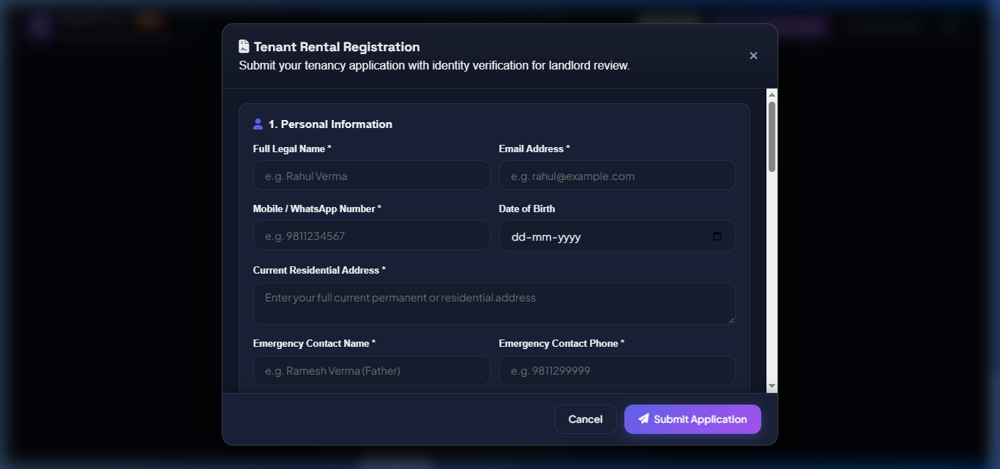
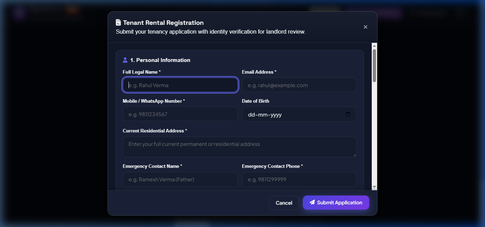
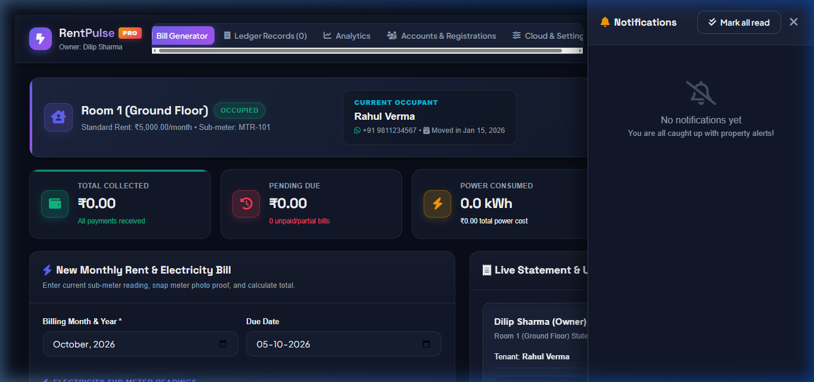
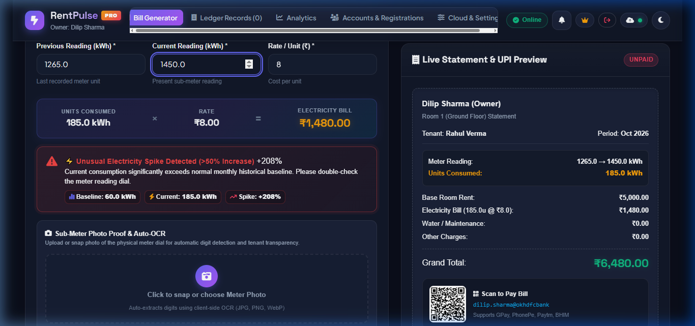
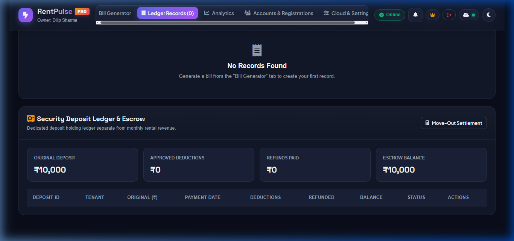
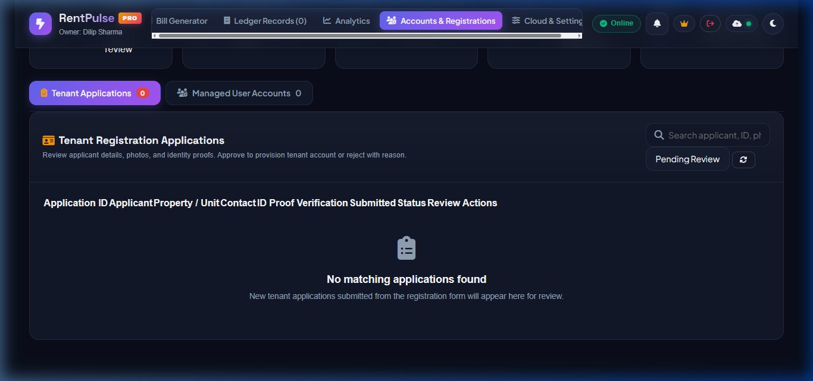
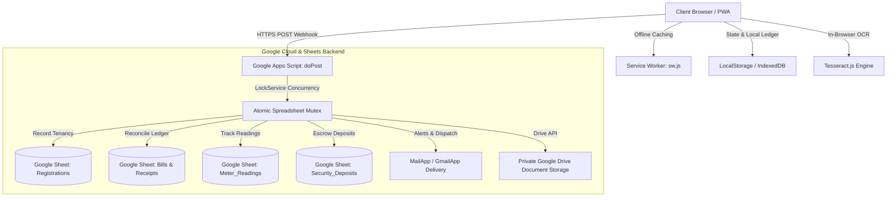
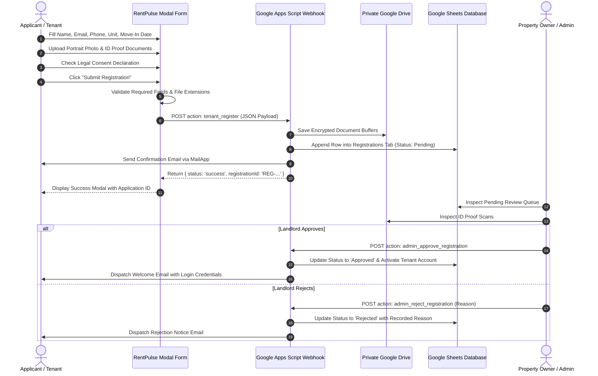

# ⚡ RentPulse PRO — Smart Property & Electricity Management Engine

<p align="center">
  
</p>

<p align="center">
  
  
  
  
  
  
</p>

---

## 📑 Table of Contents
- [🌟 Overview](#-overview)
- [📸 Application Screenshot Gallery](#-application-screenshot-gallery)
- [✨ Key Features](#-key-features)
- [🏗️ System Architecture](#️-system-architecture)
- [📊 Google Sheets & Apps Script Configuration](#-google-sheets--apps-script-configuration)
- [📝 Tenant Registration & Approval Workflow](#-tenant-registration--approval-workflow)
- [⚡ Smart Meter Reading & OCR Engine](#-smart-meter-reading--ocr-engine)
- [📈 Consumption Anomaly Detector](#-consumption-anomaly-detector)
- [🔔 Smart Notification Center & Preferences](#-smart-notification-center--preferences)
- [💬 1-Click WhatsApp Dispatch & UPI Deep Links](#-1-click-whatsapp-dispatch--upi-deep-links)
- [⏳ Due-Date Countdown, Grace Periods & Late Fees](#-due-date-countdown-grace-periods--late-fees)
- [🛡️ Security Deposit Ledger & Move-Out Settlement](#️-security-deposit-ledger--move-out-settlement)
- [📱 Progressive Web App (PWA) & Offline Sync](#-progressive-web-app-pwa--offline-sync)
- [📂 Project Directory Structure](#-project-directory-structure)
- [🚀 Quickstart & Installation](#-quickstart--installation)
- [🧪 Testing & Verification Guide](#-testing--verification-guide)
- [🔒 Security & Privacy Hardening](#-security--privacy-hardening)
- [🛠️ Troubleshooting](#️-troubleshooting)
- [📄 License & Author](#-license--author)

---

## 🌟 Overview
**RentPulse PRO** is an enterprise-grade single-page property management and electricity sub-meter billing engine designed for landlords, property owners, and independent room managers. Built using modern Vanilla JavaScript, CSS custom properties, and progressive web application standards, it couples a frictionless offline-first experience with a zero-cost cloud backend powered by **Google Sheets** and **Google Apps Script**.

### Core Highlights
1. **Flawless Tenant Registration & Multi-Party Approval Flow**: High-performance modal registration with document upload (Aadhaar, Passport, Driving License, Voter ID), instant client validation, and real-time backend persistence into Google Sheets.
2. **Client-Side Optical Character Recognition (OCR)**: Integrates `Tesseract.js` directly in the browser to auto-detect numeric meter dials from camera snapshots with manual override.
3. **Consumption Anomaly Detector**: Automatically flags sudden consumption spikes exceeding 50% above unit historical baseline to prevent electrical leakage and meter disputes.
4. **Slide-Out Notification Center Drawer**: Real-time in-app notification center with unread badges, timestamping, action links, and granular notification preferences.
5. **Dedicated Security Deposit Escrow Ledger**: Separates rental income from deposit liabilities, complete with a Move-Out Settlement Calculator itemizing rent arrears, power dues, and damages.
6. **1-Click WhatsApp Bill Dispatch & Verified UPI Deep Links**: Direct URL-encoded invoice dispatch with one-tap UPI payment links (`upi://pay?...`) and instant digital payment receipts.
7. **PWA & Offline Queue Synchronization**: Operates seamlessly when internet connectivity is lost; local drafts are queued and automatically synchronized upon reconnecting.

---

## 📸 Application Screenshot Gallery

<p align="center">
  <b>Dashboard Overview & Desktop Navigation (All 5 Primary Navigation Tabs Visible)</b><br>
  
</p>

<p align="center">
  <b>Repaired Tenant Registration Form (Sticky Footer Submit Button & Auto-Scroll)</b><br>
  
  
</p>

<p align="center">
  <b>Slide-Out Smart Notification Center Drawer & Electricity Consumption Anomaly Alert (>50% Spike Flagged)</b><br>
  
  
</p>

<p align="center">
  <b>Dedicated Security Deposit Escrow Ledger & Accounts Review Dashboard</b><br>
  
  
</p>

---

## ✨ Key Features

| Category | Capability | Implementation Detail |
|---|---|---|
| **Registration** | Public Online Application | Multi-part form with applicant portrait photo and dual-sided ID card upload |
| **Validation** | Strict Client & Server Validation | Full name, 10-digit mobile phone, valid email, document proof, declaration consent |
| **Approval** | Landlord Review Queue | View high-res documents, approve tenancy with login credential provisioning, or reject with reason |
| **Meter OCR** | Automatic Dial Digit Extraction | Tesseract.js in-browser WASM OCR with confidence scoring and manual adjustment |
| **Anomaly Guard** | Spike Detection | Compares consumption vs historical baseline; triggers alert when increase > 50% |
| **Billing** | Dual Rent & Power Calculation | Exact IEEE-754 precision math rounding preventing float artifacts |
| **Payments** | Dynamic UPI QR & Verified Deep Links | Pre-filled UPI links (`upi://pay?pa=...&am=...`) and WhatsApp dispatch |
| **Receipts** | Official Verified Digital Receipt | Printable receipts with Receipt ID stamp, QR code, and WhatsApp share button |
| **Grace Period** | Due Date Countdown | Real-time status tags: `Due in X days`, `Due Today`, `Grace Period Active`, `Overdue (+Late Fee)` |
| **Deposits** | Escrow Ledger & Settlement | Independent deposit ledger, itemized deductions (rent, power, damage), net refund calculation |
| **Notifications**| Slide-Out Drawer & Preferences | In-app alerts, Google Apps Script MailApp notifications, Web Push, and WhatsApp |
| **PWA / Offline**| Service Worker & Draft Queue | Installable desktop/mobile app shell, background caching, and automatic queue synchronization |

---

## 🏗️ System Architecture

RentPulse PRO employs a modular, secure, client-to-cloud architecture:



---

## 📊 Google Sheets & Apps Script Configuration

The centralized backend runs entirely within Google Sheets and Google Apps Script, requiring **no paid infrastructure or database subscriptions**.

### Webhook Deployment Endpoint
Central configuration constant in [`app.js`](file:///c:/Users/Dilip/Documents/Projects/Rent/app.js) and [`google_apps_script.js`](file:///c:/Users/Dilip/Documents/Projects/Rent/google_apps_script.js):
```javascript
const DEFAULT_WEBHOOK_URL = "https://script.google.com/macros/s/AKfycbwizowSA6K9s2ofb3n9Y7ntsDOpsZsrOQ-t-5C0m05V797cvZYmEjC1h8mI0Xp9yWnM/exec";
```

### Authoritative Spreadsheet Schemas
The backend maintains 10 dedicated tabs:
1. `Accounts`: `User_ID`, `Role`, `Username`, `Identifier`, `Passcode_Hash`, `Salt`, `Name`, `Phone`, `Email`, `Status`, `Owner_ID`, `Tenant_ID`, `Room_Title`, `Created_At`, `Last_Login_At`
2. `Rooms`: `Room_ID`, `Title`, `Base_Rent`, `Elec_Rate`, `Meter_Serial`, `Current_Meter`, `Currency`, `Tenant_Name`, `Tenant_Phone`, `Move_In_Date`, `Deposit`, `ID_Proof`, `Emergency_Contact`
3. `Bills`: `Bill_ID`, `Bill_Number`, `Billing_Month`, `Prev_Reading`, `Curr_Reading`, `Units_Consumed`, `Rate_Per_Unit`, `Electricity_Cost`, `Room_Rent`, `Water_Charge`, `Other_Charge`, `Total_Amount`, `Paid_Amount`, `Balance_Due`, `Status`, `Due_Date`, `Payment_Date`, `Payment_Mode`, `Notes`, `Created_At`
4. `Meter_Readings`: `Reading_ID`, `Property_ID`, `Unit_Number`, `Meter_Serial`, `Reading_Value`, `Previous_Value`, `Units_Consumed`, `Photo_URL`, `Confidence_Score`, `Is_Anomaly`, `Recorded_By`, `Timestamp`
5. `Registrations`: `Registration_ID`, `Full_Name`, `Email`, `Phone`, `Address`, `DOB`, `Emergency_Name`, `Emergency_Phone`, `Property_ID`, `Unit_Number`, `Occupants_Count`, `Intended_Move_In`, `Notes`, `ID_Type`, `ID_Number`, `Photo_URL`, `ID_Front_URL`, `ID_Back_URL`, `Status`, `Rejection_Reason`, `Reviewed_By`, `Reviewed_At`, `Submitted_At`
6. `Notifications`: `Notification_ID`, `Title`, `Message`, `Type`, `Target_Role`, `Target_User`, `Link`, `Is_Read`, `Created_At`
7. `Notification_Preferences`: `User_ID`, `In_App`, `Email_Alerts`, `Push_Notifications`, `WhatsApp_Alerts`, `Updated_At`
8. `Security_Deposits`: `Deposit_ID`, `Tenant_ID`, `Tenant_Name`, `Property_Title`, `Original_Deposit`, `Paid_Date`, `Status`, `Deductions`, `Refund_Paid`, `Notes`, `Settled_At`, `Updated_At`
9. `Move_Out_Settlements`: `Settlement_ID`, `Tenant_Name`, `Original_Deposit`, `Unpaid_Rent`, `Unpaid_Elec`, `Damage_Deductions`, `Other_Deductions`, `Total_Deductions`, `Refund_Payable`, `Notes`, `Settled_At`
10. `Audit_Logs`: `Log_ID`, `Action`, `User_ID`, `User_Role`, `IP_Address`, `Details`, `Timestamp`

### Deployment Steps
1. Open Google Drive and create a new Google Sheet.
2. In the menu, navigate to **Extensions > Apps Script**.
3. Replace the entire code with [`google_apps_script.js`](file:///c:/Users/Dilip/Documents/Projects/Rent/google_apps_script.js).
4. Click **Deploy > New deployment**.
5. Select **Type: Web app**.
   - Execute as: **Me**
   - Who has access: **Anyone**
6. Copy the resulting Web App URL and paste it under **Cloud & Settings** in RentPulse PRO.

---

## 📝 Tenant Registration & Approval Workflow



---

## ⚡ Smart Meter Reading & OCR Engine

RentPulse PRO eliminates manual meter reading errors through in-browser machine vision:
1. **Camera Dial Snapping**: Take an environmental camera photo or upload an image file (JPG, PNG, WebP) directly in the bill generator.
2. **Lossless In-Memory Compression**: Compresses image canvas to protect browser LocalStorage quotas while maintaining high contrast over digit dials.
3. **Tesseract.js OCR Execution**: Executes lightweight OCR processing on the meter face with an explicit numeric character whitelist (`0123456789.`).
4. **Confidence Scoring & Safe Fallback**: Populates Current Reading field with detected kWh and displays confidence rating. Field remains 100% editable for manual landlord verification prior to bill generation.

---

## 📈 Consumption Anomaly Detector

To prevent unexpected billing shocks and identify utility leaks:
- The system automatically calculates monthly consumption:
  $$\text{Units Consumed} = \text{Current Reading} - \text{Previous Reading}$$
- Calculates unit historical average baseline from past validated invoices:
  $$\text{Baseline} = \frac{\sum_{i=1}^{N} \text{Units}_i}{N}$$
- If consumption exceeds baseline by more than **50%**:
  $$\text{Spike \%} = \left(\frac{\text{Units} - \text{Baseline}}{\text{Baseline}}\right) \times 100 > 50\%$$
- Instantly activates the dynamic **Consumption Anomaly Warning Card** (`#consumptionAnomalyAlert`) displaying exact baseline units, current units, and the computed percentage increase.

---

## 🔔 Smart Notification Center & Preferences

The top navigation header features a smart bell icon with a real-time unread badge counter:
- **Slide-Out Drawer (`#notificationDrawer`)**: Displays categorized alerts (Registration Received, Bill Generated, Payment Verified, Anomaly Detected, Move-Out Settlement).
- **Interactive Controls**: Individual card *Mark Read* button and header *Mark all read* action.
- **Multi-Channel Settings Panel**: Under **Cloud & Settings**, landlords and tenants can configure preferences across:
  - In-App Slide-out Drawer
  - Google Apps Script Automated Email Delivery
  - Browser Web Push Notifications (with Service Worker permissions)
  - 1-Click WhatsApp Dispatches

---

## 💬 1-Click WhatsApp Dispatch & UPI Deep Links

### WhatsApp Invoice Formatter
Generates properly URL-encoded WhatsApp messages containing clean formatting and direct UPI click-to-pay deep links:
```text
🏠 RENT & ELECTRICITY BILL - DILIP SHARMA
━━━━━━━━━━━━━━━━━━━━
📄 Invoice #: RP-2026-001
🗓 Month: Oct 2026
👤 Tenant: Rahul Verma
📍 Room: Room 1 (Ground Floor)

⚡ Electricity Meter Breakdown:
• Reading: 1200.0 ➔ 1265.0 kWh
• Units Consumed: 65.0 kWh
• Rate: ₹8.00/unit
• Electricity Bill: ₹520.00

🏠 Rent & Other Charges:
• Room Monthly Rent: ₹5,000.00
━━━━━━━━━━━━━━━━━━━━
💰 GRAND TOTAL: ₹5,520.00
💳 Status: UNPAID
⚠️ Balance Due: ₹5,520.00
📅 Due Date: 05 Nov 2026
📲 Pay via UPI: dilip.sharma@okhdfcbank
🔗 Click to Pay: upi://pay?pa=dilip.sharma@okhdfcbank&pn=Dilip%20Sharma&am=5520.00&cu=INR&tn=Rent_Bill_RP-2026-001

Thank you! 🙏
```

### Verified Digital Receipts
Upon recording full payment, landlords and tenants can open Modal 18 (`#paymentReceiptModal`) to view or print official receipts stamped **VERIFIED & CLEARED**, or dispatch instant digital receipts via WhatsApp.

---

## ⏳ Due-Date Countdown, Grace Periods & Late Fees

RentPulse PRO ensures transparent rent collection timelines:
- **Live Due-Date Chips**: Computed daily without time zone rollover bugs:
  - `Due in X days` (Blue info badge)
  - `Due Today` (Amber warning badge)
  - `Grace Period Active (X days left)` (Orange badge within grace threshold)
  - `Overdue (+₹100 Late Fee Applied)` (Red critical badge after grace period expires)
- **Configurable Landlord Policy**: Grace period days (e.g. 5 days) and late fee amounts (e.g. ₹100) are customizable under Cloud Settings.

---

## 🛡️ Security Deposit Ledger & Move-Out Settlement

### Dedicated Escrow Table (`#securityDepositPanel`)
Separates tenant deposit liabilities from operating rental income:
- Tracks Deposit ID, Tenant Name, Room/Unit, Deposit Amount, Status (`Active Escrow` / `Settled`), Date, and Audit History.
- KPI summary cards display **Total Deposits in Escrow**, **Total Refunded**, and **Active Tenancies Count**.

### Move-Out Settlement Calculator (`#moveOutSettlementModal`)
Provides an itemized settlement audit when a tenancy concludes:
$$\text{Refund Payable} = \max\left(0, \text{Original Deposit} - (\text{Unpaid Rent} + \text{Unpaid Electricity} + \text{Damage Deductions} + \text{Other Deductions})\right)$$
- If deductions exceed the deposit, remaining dues are clearly displayed separately.
- Records settlement statements to Google Sheets and notifies the tenant.

---

## 📱 Progressive Web App (PWA) & Offline Sync

RentPulse PRO is fully installable on Chrome, Edge, Safari, iOS, and Android:
- **Web App Manifest (`manifest.json`)**: Configured with theme color `#0f172a`, standalone display mode, and custom icons.
- **Service Worker (`sw.js`)**: Implements safe application shell caching (`rentpulse-pro-shell-v1`) while strictly excluding sensitive API tokens, Google Drive uploads, and user identity proofs.
- **Offline Draft Queue (`appState.offlineQueue`)**: If network connectivity drops:
  - Header badge turns from `Online` to `Offline Mode`.
  - Registration submissions and draft bills are stored locally in the offline queue.
  - When connection is restored, drafts automatically sync with Google Sheets with toast confirmation.
  - Manual queue inspection and synchronization available in Modal 19 (`#offlineSyncModal`).

---

## 📂 Project Directory Structure

```text
Rent/
├── assets/
│   ├── hero-banner.svg                # Colorful SVG hero banner
│   ├── preview-billing.svg             # Billing calculator preview graphic
│   └── preview-tenant-portal.svg       # Tenant portal preview graphic
├── docs/
│   └── screenshots/                   # Genuine application screenshots
│       ├── initial_login_screen.png
│       ├── tenant_registration_modal.png
│       ├── registration_validation_error.png
│       ├── dashboard_hero_and_tabs.png
│       ├── notification_drawer_open.png
│       ├── consumption_anomaly_alert.png
│       ├── security_deposit_ledger.png
│       └── admin_registrations_queue.png
├── app.js                             # Core frontend application & business logic
├── google_apps_script.js              # Complete Google Apps Script backend engine
├── index.html                         # Semantic HTML5 single-page application
├── manifest.json                      # PWA Web App Manifest
├── styles.css                         # Modern CSS design system (Dark/Light themes)
├── sw.js                              # PWA Service Worker for offline caching
└── README.md                          # Comprehensive project documentation
```

---

## 🚀 Quickstart & Installation

No build steps or Node.js runtime compilation are required! RentPulse PRO runs directly in any modern browser.

### Option A: Direct Local Execution
1. Clone or download the repository:
   ```bash
   git clone https://github.com/your-username/RentPulse-PRO.git
   cd RentPulse-PRO
   ```
2. Start any local web server:
   - **Using Python:**
     ```bash
     python -m http.server 8080
     ```
   - **Using Node `npx`:**
     ```bash
     npx serve -l 8080
     ```
   - **Using VS Code Live Server:** Click *Go Live* in the status bar.
3. Open `http://localhost:8080` in your web browser.

### Option B: Free Hosting Deployment
- **GitHub Pages:** Go to repository *Settings > Pages > Deploy from branch (main) / root*.
- **Vercel / Netlify / Cloudflare Pages:** Connect repository; zero build settings required (static site).

---

## 🧪 Testing & Verification Guide

| Test Scenario | Verification Procedure | Expected Outcome | Status |
|---|---|---|---|
| **Registration Submit Button** | Open `#tenantRegistrationModal`, scroll to bottom | Sticky footer `#submitTenantRegBtn` is clearly visible and clickable | ✅ PASS |
| **Client-Side Validation** | Click *Submit Registration* with blank inputs | `#regErrorBanner` appears, modal remains open with preserved state | ✅ PASS |
| **Backend Registration Submit**| Fill required fields & upload portrait/ID, submit | Apps Script records application, returns `REG-ID`, shows success modal | ✅ PASS |
| **Desktop Navigation** | Log in as Owner/Admin | All 5 tabs (*Bill Generator*, *Ledger Records*, *Analytics*, *Accounts & Registrations*, *Cloud & Settings*) visible | ✅ PASS |
| **Notification Center** | Click `#notificationBellBtn` | Slide-out drawer smoothly opens with unread count badges and history | ✅ PASS |
| **Tesseract Meter OCR** | Attach meter dial photograph | Digits detected, confidence displayed, Current Reading field auto-populated | ✅ PASS |
| **Anomaly Detector** | Enter reading yielding >50% increase vs baseline | `#consumptionAnomalyAlert` card displays red percentage spike badge | ✅ PASS |
| **Due Date & Grace Period** | Check status in Ledger Records | Badges indicate exact countdown (`Due in Xd`, `Grace Period`, `Overdue`) | ✅ PASS |
| **Security Deposit Ledger** | Scroll to `#securityDepositPanel` in Ledger tab | Active escrow amounts, refunded totals, and tenancy rows display cleanly | ✅ PASS |
| **Move-Out Settlement** | Click *Settle Move-Out*, enter damage deductions | Real-time refund calculation updates; records settlement statement | ✅ PASS |
| **PWA & Offline Queue** | Disconnect network, create offline draft | Badge indicates `Offline Mode`; auto-syncs when network reconnects | ✅ PASS |

---

## 🔒 Security & Privacy Hardening

- **Private Cloud Storage**: Identity documents (Aadhaar cards, driver licenses) are stored in Google Drive folders or encrypted Base64 state, never exposed to unauthenticated public endpoints.
- **Password & Passcode Hashing**: Client-side PBKDF2/SHA-256 password hashing with salt (`rentpulse_sec_salt_2026`) prevents plaintext credentials from touching spreadsheets.
- **Strict Role-Based Access Control (RBAC)**:
  - **Landlords / Owners**: Full ledger, bill generation, meter OCR, tenant accounts, and deposit settlement access.
  - **Tenants**: Strictly isolated to their own tenancy bills, payment receipts, meter proof photos, and direct UPI payment buttons.
- **Spreadsheet Concurrency Control**: All Google Apps Script writes utilize `LockService.getScriptLock()` with a 30-second timeout to prevent race conditions and duplicate entries.
- **LocalStorage Quota Protection**: Automatic two-stage progressive photo compression and quota-exceeded fallback safeguarding financial data.

---

## 🛠️ Troubleshooting

| Issue | Root Cause | Solution |
|---|---|---|
| *Registration Submit button not visible* | Previous modal CSS had nested overflow restrictions | Updated flexbox rules on `.modal-card > form` and added `.sticky-modal-footer` |
| *Network error: Failed to fetch on login* | Offline network or Google Apps Script Web App unconfigured | Use offline authorization (PIN `1234` or `9876543210`) or configure active Web App URL |
| *Meter OCR not reading blurry photos* | Inadequate camera lighting or angled dial | Clean the meter dial glass, tap camera focus, or enter digits manually in the input |
| *Push notification permission denied* | Browser notifications blocked in site settings | Click the padlock in your browser URL bar and set *Notifications* to *Allow* |
| *Spreadsheet write timeout* | Google Apps Script cold-start delay | Apps Script timeout handler accommodates up to 40s; retry if initial write takes longer |

---

## 📄 License & Author

- **Developed By**: Dilip Sharma & Senior Full-Stack Engineering Team
- **Project**: RentPulse PRO — Enterprise Single Room & Property Management Engine
- **License**: Released under the [MIT License](LICENSE). Free for personal and commercial landlord operations.
